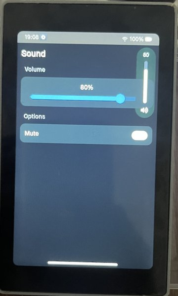

# KSDIY ESP32-P4C5 Phone

ESP-Brookesia phone firmware for the KSDIY ESP32-P4C5 4.3" board (480 x 800 panel, ST7102 over MIPI DSI, ST7123 touch),
on top of the board support package [esp32p4c5_bsp](https://github.com/ngttai/esp32p4c5_bsp) (v0.2.1, fetched by the
component manager). It was the `examples/phone` of that repository until v0.1.0 and has its own history since.

## What it does

- **Phone shell**: launcher, status bar, quick settings, lock screen, boot splash, keys or gesture navigation, Vietnamese / English.
- **Settings**: Wi-Fi (saved networks, auto-reconnect), 4G, display, sound, language, time zone, power, About, and debug pages (system monitor, network, memory and card speed).
- **Apps**: Level, Camera, Gallery, Weather, Music, Radio, Recorder, LED RGB, Video, Files (and USB drive), Second screen, USB camera, AI Assistant, Calculator, 2048.
- **Connectivity**: Wi-Fi through the ESP32-C5 (ESP-Hosted) and 4G through the ML307C module, with Wi-Fi first.
- **microSD**: mounted at `/sdcard` at boot, never formatted.

| Lock screen | Launcher | Settings |
|---|---|---|
|  |  |  |

| About | Sound page with the volume panel |
|---|---|
|  |  |

## Documentation

- [docs/features.md](docs/features.md): every app and system behavior in detail (settings, media apps, keys, microSD layout).
- [docs/4g.md](docs/4g.md): mobile data (module, PPP, Wi-Fi first, speed, data counter).
- [docs/architecture.md](docs/architecture.md): source layout, configuration and implementation notes.

## Requirements

- KSDIY ESP32-P4C5 4.3" board (ESP32-P4 rev v3.2, 16 MB flash, 32 MB PSRAM) with the on-board ESP32-C5 running the ESP-Hosted co-processor firmware 2.12.13 (as shipped).
- ESP-IDF v6.1, and Internet access at the first build (the component manager fetches the BSP from GitHub and the other components from the Espressif registry).
- Optional: SC2336 or OV2710 camera on the CSI connector, SIM card in the ML307C module (needs the battery), battery on J2, microSD card, speaker.

## Build and Flash

Run from the root of this repository:

```
idf.py set-target esp32p4
idf.py -p {port} flash monitor
```

To exit the serial monitor, type `Ctrl-]`.

Since v0.1.0 the partition table has a `model` partition (960 KB at `0xF10000`) for the wake word: a board flashed with v0.1.0 needs a full `idf.py flash` (partition table and `srmodels.bin`), not only the app.

## Third-party assets

- Fonts: Be Vietnam Pro (UI and clock) and Noto Sans CJK (Chinese text of the AI Assistant), SIL Open Font License 1.1, see `components/phone_app_settings/fonts/OFL.txt` and `OFL-NotoSansCJK.txt`.
- ESP-Brookesia (`components/brookesia_core`, Calculator, 2048, Squareline demo), `esp_xiaozhi`, the EAF decoder and the local `esp_driver_sdmmc`: Apache-2.0, from Espressif.
- The eye animations of the AI Assistant (`components/phone_app_assistant/emote/`) are taken from Espressif's "Emote Pack" (https://dl.espressif.com/AE/Emote%20Pack.zip), published by Espressif as open source sample material of `espressif2022/esp_emote_gen_player` (Apache-2.0). The pack itself has no license file.

## Version

The About page shows the version from `git describe` (for example `v0.1.0`, or `v0.1.0-3-gabcdef0-dirty` for a later build).
