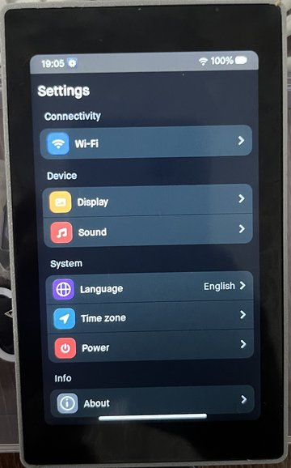

# KSDIY ESP32-P4C5 Phone

ESP-Brookesia phone firmware for the KSDIY ESP32-P4C5 4.3" board, on top of the board support package
[esp32p4c5_bsp](https://github.com/ngttai/esp32p4c5_bsp) (v0.2.1, fetched by the component manager). It was the
`examples/phone` of that repository until v0.1.0 and has its own history since.

## Overview

Runs the ESP-Brookesia Phone UI on the KSDIY ESP32-P4C5 4.3" board (480 x 800 panel, ST7102 over MIPI DSI, ST7123 touch), with a settings app and the system behavior of a small phone:

- **Launcher** with the Settings, Level, Camera, Gallery, Weather, Music, Radio, Recorder, LED RGB, Video, Files, Second screen, USB camera, AI Assistant, Calculator, 2048 and Squareline demo apps. The status bar shows the clock, the 4G signal (with a "4G" mark while mobile data carries the traffic), the Wi-Fi level (grey while Wi-Fi is on but not connected) and the battery.
- **Settings app** (Vietnamese / English):
  - Wi-Fi: scan, connect, up to 5 saved networks with auto-reconnect (the last used network first), forget. The Wi-Fi switch is kept across restarts.
  - Mobile network (4G): 4G and mobile data switches, status, operator, signal, data state and address, data used (kept across restarts, with a reset), APN and address given by the network, SIM (ICCID, IMSI) and module. A hint explains a problem (no SIM, PIN, network refusal, no data). See [4G (mobile data)](#4g-mobile-data).
  - Display: brightness, screen timeout.
  - Sound: volume and mute.
  - Language, time zone (SNTP once Wi-Fi or 4G is up).
  - Power: power off and restart.
  - About: device (chip, RAM, PSRAM and flash size, MAC), software versions (app, ESP-IDF, ESP32-C5 firmware, ESP-Hosted, LVGL, Brookesia), detected hardware, microSD size, battery and charger.
  - Debug: system monitor, a small box over every screen with the load of both CPU cores, the frames drawn per second, the free / usable internal SRAM (with the lowest and the largest block), the DMA-capable RAM and the PSRAM; the same figures go to the log (tag `SYSMON`) every 5 s, with the three busiest tasks. Turning it on also logs an internal RAM report (tag `MEMDUMP`): task stacks, heap blocks by size, the largest ones and the blocks taken since the last report.
    Reading the box, for example `SRAM 123/398K min 114K max 86K`, `DMA 86K max 68K`, `PSRAM 16.8/22.7M max 16.5M` (refreshed every second):
    - `123/398K`: free now / total heap. The internal heap is 398K of the 768 KB SRAM; the rest holds the L2 cache (256 KB), code run from RAM and static data. The PSRAM heap is 22.7M of the 32 MB; the firmware itself runs from the rest (XIP).
    - `min 114K`: the lowest free internal RAM since boot. It only goes down (it does not grow back when apps free memory); near 0 means the phone once almost ran out.
    - `max 86K`: the largest free contiguous block **now**, the biggest single allocation that can succeed at this moment (`heap_caps_get_largest_free_block()`). Free 123K with a largest block of 86K means the free memory is split; it is not the largest block ever allocated.
    - `DMA`: the part of the internal RAM that DMA can reach (microSD, I2S, SDIO to the C5, USB): free now and largest block. The one to watch: the USB camera rebooted when it fell below about 70K, before its buffers moved to PSRAM.
  - Debug: Network speed (over Wi-Fi, or 4G when Wi-Fi is off), a 10 s HTTP download or upload to a PC on the same network running `tools/speed_server.py` (found by its UDP broadcast) or to speed.cloudflare.com; shows the running test (Mbps, the lowest free SRAM / DMA RAM; log tag `SPEEDTEST`) and the last download and upload results. Measured with a 32 KB TCP window over Wi-Fi: about 11 Mbps down and 4 to 7 Mbps up to a PC, 3 to 5 Mbps down from Cloudflare; over 4G about 0.6 to 0.7 Mbps each way.
  - Debug: 4G module test, with 4G off: powers the module, then identity, SIM, network, the UART rates it takes, CMUX and a PPP dial; every command and answer goes to the page and the log (tag `CELL`).
  - Debug: Memory speed, write (memset), read and copy (memcpy) in MB/s on PSRAM (1 MB buffers, larger than the 256 KB L2 cache) and on internal SRAM (log tag `MEMBENCH`). Measured with PSRAM at 200 MHz (HEX, x16): PSRAM write 166, read 188, copy 81; SRAM write 1007, read 1212, copy 551. At 250 MHz the PSRAM was 12 to 20% faster (read 210, write 199, copy 91) but SD card writes timed out, so it stays at 200 MHz. The same page tests the microSD card: an 8 MB file written then read through FAT with a 32 KB buffer in SRAM and a 64 KB buffer in PSRAM, then deleted (log tag `SDBENCH`); measured on a 32 GB card at 40 MHz: write 3.9 to 5.4 MB/s, read 14 to 16.7 MB/s.
- **Level app**: two-axis spirit level on the IMU accelerometer. The bubble floats toward the higher side and turns green within 0.5° on both axes; Calibrate stores the current position as zero.
- **Camera app**: live preview of the CSI sensor (cropped, scaled and rotated by the PPA) and photos saved as JPEG (hardware encoder) in `/sdcard/DCIM`. The sensor is powered down when the app is in the background.
- **Gallery app**: the photos of `/sdcard/DCIM` as a grid of thumbnails, newest first, with a viewer (previous / next by buttons or swipe) and delete. Photos are decoded by the hardware JPEG decoder and scaled by the PPA.
- **Weather app**: current conditions and a 7-day forecast from [open-meteo.com](https://open-meteo.com) (HTTPS, no key) for a city picked from a list. Needs Internet (Wi-Fi or 4G).
- **Music app**: plays the MP3, WAV, FLAC, AAC, M4A and OGG files of the card (up to three folder levels deep) on the speaker (mono), with play / pause, previous, next, repeat (off, list, one track), shuffle and auto-advance. Drag the progress bar to seek (MP3, AAC, WAV and FLAC). A star on every row marks favorites, kept in `/sdcard/appdata/music/favorites.txt`, and a filter shows all tracks or the favorites only. A tap on the artwork switches it to a rainbow spectrum (remembered); a crossed speaker badge breathes over it while the phone is muted. MP3 files show the title, artist and duration of their ID3 tag, read in the background, and the JPEG cover of the tag (baseline JPEG only; a colored placeholder otherwise). It keeps playing in the background and with the screen off, and follows the phone volume. The newest player gets the speaker: Music and Radio stop for each other, and Video or the AI Assistant stop them (`phone_audio_speaker_take_yielding()`; the holder gives the speaker back at once).
- **Radio app**: internet radio through the GMF simple player, as in MetalioClaw4: HLS (`.m3u8`; AAC, MP3 or MPEG-TS segments) and direct Icecast / Shoutcast streams (MP3, AAC, OGG, FLAC; the type is found in the data, so URLs without an extension work). For direct streams the song title of the ICY metadata replaces "Playing" (the metadata blocks are taken out of the sound in the HTTP read hook; `patches/gmf_io-http-on-header.patch` passes the response headers, `icy-metaint` and `Content-Type`, to that hook). The app shows station name, status, stream format, a 12-band spectrum (`gmf_fft`), previous / play-stop / next, volume, and the station list. The stations are **only** in `/sdcard/appdata/radio/stations.json` on the card, there is no list in the firmware: `{"stations": [{"name": "VOV1", "url": "https://.../playlist.m3u8"}, ...]}` (or a bare array), up to 100 stations and 64 KB; entries without a name or an http(s) URL are skipped. A sample with 13 Vietnamese stations and 5 English ones (music, news) is in `sdcard/appdata/radio/stations.json`: copy it to the card (USB drive of the Files app). Without the file the app says why and offers Retry; it never writes to the card. The last station is remembered and plays when the app opens. It keeps playing in the background and with the screen off; closing the app stops it. Played at the rate of the stream, mixed to mono. The HLS `.aac` segments start with an ID3 tag that the GMF decoder takes for MP3: `patches/gmf_audio-hls-aac.patch` (from MetalioClaw4) is applied to `managed_components/espressif__gmf_audio` by `CMakeLists.txt` at every configure.
- **Video app**: plays videos of the card in full screen (the status bar hides), with play / pause, previous / next and a progress bar to seek. Landscape videos are turned to fill the portrait screen and the controls turn with them.
  - `.avi` with Motion JPEG and 16-bit PCM sound: hardware JPEG decoder, PPA scaling.
  - `.mp4` with H.264 **constrained baseline** and AAC sound: the ESP32-P4 has no H.264 decoder, so the software decoder of `espressif/esp_h264` runs on core 1 (`espressif/esp_extractor` reads the file). 640 x 360 test clips decode in about 21 ms a frame, but a real music video took 34 ms (40% of its frames late at 25 fps), so convert to 20 fps; 640 x 480 drops some frames, 800 x 480 about half. Main and High profile files (most YouTube downloads) do not play.

  Convert other videos first:

  ```
  ffmpeg -i in.mp4 -vf "scale=640:360:force_original_aspect_ratio=decrease:force_divisible_by=2" -r 20 -c:v libx264 -profile:v baseline -level 3.1 -bf 0 -g 48 -crf 23 -pix_fmt yuv420p -c:a aac -b:a 64k -ar 22050 -ac 1 -movflags +faststart out.mp4
  ffmpeg -i in.mp4 -vf "scale=800:480:force_original_aspect_ratio=decrease:force_divisible_by=2" -r 20 -c:v mjpeg -q:v 5 -pix_fmt yuvj420p -c:a pcm_s16le -ar 22050 -ac 1 out.avi
  ```
- **Second screen app**: the board as a USB display with touch for a PC, 480 x 800 portrait or 800 x 480 landscape (turned by the PPA), on the USB HS Type-C socket (high-speed device 303A:2986, "udisp" protocol of the [xfz1986 USB graphic driver](https://github.com/chuanjinpang/win10_idd_xfz1986_usb_graphic_driver_display), for Windows and Linux). The PC sends JPEG pictures, decoded by the hardware decoder; touches go back as a HID touch screen. Measured: about 8.6 MB/s from the PC, 30 to 58 pictures per second shown.
- **USB camera app**: live picture of a UVC webcam on the Type-A host socket (MJPEG at 640 x 480, hardware JPEG decoder; the USB host of the ESP32-P4 only takes isochronous endpoints of one transaction per microframe, see `patches/usb_host_uvc-single-transaction-isoc.patch`) and photos saved in `/sdcard/DCIM`. The app turns the 5 V boost on for the socket and releases the USB port in the background. Leave the USB HS Type-C socket unplugged while a webcam is in use: both sockets share one port.
- **AI Assistant app**: voice assistant on the [xiaozhi.me](https://xiaozhi.me) service through the `esp_xiaozhi` component. The first run shows the activation code to enter on the site. Then one button starts a conversation: the microphone is sent as Opus over WebSocket, the answer is played on the speaker and shown as chat bubbles under an animated face, and the assistant listens again after each answer until the button or the server ends the conversation. Half duplex. While the app is open and idle, the wake word "Hi ESP" (esp-sr WakeNet 9, model in the `model` partition) starts a conversation like the button; the session tasks keep their stacks in PSRAM, so the app leaves about 110 KB of internal RAM free.
- **Recorder app**: records the microphone to WAV files (16 kHz, mono, 16 bit, about 1.9 MB a minute) in `/sdcard/Recordings`, named by date and time; a wave of the level while recording or playing, the recordings newest first (tap: play / pause; trash button: tap twice to delete). Recording goes on behind the lock screen, with the screen off and from the home screen; closing the app ends it and keeps the file. The WAV header is written again every few seconds, so a file cut by a reset still plays. One microphone is recorded (the BSP I2S link is mono).
- **LED RGB app**: the RGB LED of the board (one WS2812B) as a small lamp: effect (solid, blink, breathe, rainbow), color (quick colors and a hue bar), speed and brightness, applied at once. The light starts off each time the app opens, stays on from the home screen and with the screen off, and goes off when the app is closed; nothing is stored. The LED is shared through `phone_led` (Settings component): one request per user, the highest priority shown (the Recorder blinks red over the lamp while it records), effects run by an esp_timer only while one animates.
- **Files app**: browse the microSD card, read text files (`.txt`, `.json`, `.md`, `.log`, `.csv`, `.m3u8`, `.srt`, ..., first 32 KB), see the details of a file, delete files and empty folders. The USB button lends the card to a PC as a USB drive (mass storage, high speed, on the USB HS Type-C socket) until it is turned off or the app is left; the card is never formatted. Measured with GNOME Disks on a 32 GB card: 7.2 MB/s read, 4.8 MB/s write. The automatic stop command (CMD12) of a multiple block write breaks during long bursts on this board (the SDMMC host is shared with the SDIO link of the ESP32-C5), so writes use SET_BLOCK_COUNT (CMD23) instead, through a local copy of `esp_driver_sdmmc` (see `components/esp_driver_sdmmc/README_LOCAL.md`); a card without CMD23 is written one sector at a time (about 450 KB/s). The Music, Video and Gallery apps keep files of the card open while they run, so close them first.
- **Navigation** (Settings > System > Navigation, applied after a restart): three keys (default; a swipe up from the bottom edge shows Back, Home and Recents, in apps and on the launcher) or gestures (swipe from the left or right edge: back; quick swipe up from the bottom edge: home; swipe up and hold: recents; thin hint bars follow the finger). Back steps out of the open page of an app (Settings sub-pages, Files folders and viewer, Gallery viewer, Video player, ...) before closing it.
- **Quick settings**: pull down from the top edge (the panel follows the finger): time, date, battery, a button to Settings, Wi-Fi, Silent, 4G and Mobile data tiles (a long press on Wi-Fi, 4G or Mobile data opens its Settings page) and brightness and volume sliders, shared with Settings and the volume keys. A swipe up from its handle or a tap below closes it; gestures made on it do not reach the launcher or the apps. Not on the lock screen.
- **Boot splash**: over every screen until the phone is ready, then it fades out. Chosen in menuconfig, `Phone boot splash` (`CONFIG_PHONE_BOOT_SPLASH`):
  - Logo: the animated logo, QOI frames at 15 fps made from a Lottie file by `components/phone_boot_splash/tools/make_splash.py`.
  - Simple (default): a hand-drawn line draws itself, then "Xin chào!" or "Hello!" (the phone language) fades in. Drawn by LVGL, no image; smoother than the logo.
  - None.
- **Lock screen**: flip clock, date, Wi-Fi and battery, slide to unlock, charging effect. The wallpaper is the launcher one, blurred at boot.
- **Screen power**: the screen dims after the timeout, then goes off with the lock screen up. While it is off, LVGL is paused and Wi-Fi uses modem sleep.
- **Keys**:
  - Power key, short press: lock screen, then screen off; wakes the screen when it is off.
  - Power key, long press: power menu (power off, restart).
  - IO0 / BOOT: volume up / down, with a volume panel under the status bar. They do nothing on the lock screen.
- **microSD**: mounted at `/sdcard` in the background at boot (never formatted). Layout (`components/phone_app_settings/phone_paths.h`):
  - `DCIM/`, `Music/`, `Videos/`: the user's media, under the usual names.
  - `apps/`: left to apps installed on the card (ESP-Brookesia can install apps there).
  - `appdata/<app>/`: what an app keeps: `appdata/radio/stations.json`, `appdata/music/favorites.txt`, `appdata/assistant/emote/*.eaf`
    (faces that replace the built-in ones). The `sdcard/` folder of this repository is a sample of it.
  - `system/`: files of the system itself (the card speed test).
  - Cards from v0.1.0: `radio/stations.json` and `Music/favorites.txt` are still read when the new file is not there
    (favorites are written to the new place at the next change).

Settings are stored in NVS (namespace `phone`).

| Lock screen | Launcher | Settings |
|---|---|---|
|  |  |  |

| About | Sound page with the volume panel |
|---|---|
|  |  |

## 4G (mobile data)

- Module: ML307C (LTE Cat.1, AT firmware) on a UART through a level shifter (no RTS/CTS). It runs from the battery: without one it does not answer. 4G is off by default; Settings > Mobile network or the quick settings tile turns it on (kept across restarts).
- Mobile data: PPP through `esp_modem` at 921600 baud. The module does not take CMUX (`AT+CMUX` answers `+CME ERROR: 4`), so data runs in plain data mode: while data flows over 4G, the signal and operator stay at their last values.
- Wi-Fi first: with 4G and mobile data on, the module stays registered (the signal keeps updating) and PPP waits ("Standby (Wi-Fi)"). PPP comes up when Wi-Fi has been lost for 15 s (at once when the user turns Wi-Fi off) and goes down when Wi-Fi has been back for 30 s. DNS follows the interface in use (`CONFIG_ESP_NETIF_SET_DNS_PER_DEFAULT_NETIF`). The apps that need the Internet (Weather, Assistant, Radio) check Wi-Fi or 4G, and the Radio starts again as soon as either is back.
- APN: the one the network gives (`AT+CGCONTRDP`), else a small table by operator. Tried with an Onomondo SIM (roaming on Viettel) and a Vinaphone SIM: both worked without any setting.
- Speed: about 0.6 to 0.7 Mbps each way, the limit of the 921600 baud UART (about 0.74 Mbps with 8N1), whatever the operator.
- Data used: the bytes through PPP, counted in `phone_cell.cpp` (linker wrappers of `esp_netif_transmit` / `esp_netif_receive`), saved in NVS every MB and when data goes down.

## Hardware Requirements

* KSDIY ESP32-P4C5 4.3" board (ESP32-P4 rev v3.2, 16 MB flash, 32 MB PSRAM).
* On-board ESP32-C5 with the ESP-Hosted co-processor firmware 2.12.13 (as shipped) for Wi-Fi.
* On-board LSM6DS3TR-C IMU for the Level app.
* Optional: SIM card in the on-board ML307C 4G module (needs the battery).
* Optional: SC2336 or OV2710 camera module on the CSI connector (Camera app).
* Optional: battery on J2 (battery level, running without USB), microSD card, speaker.

## Software Requirements

* ESP-IDF v6.1.
* Internet access at the first build: the component manager fetches the BSP from GitHub and the other components from the Espressif registry.

## Layout

- `main/`: `main.cpp` starts the BSP display, the LVGL lock, the phone UI, the app registry and the services below.
- `components/phone_app_settings/`: the Settings app and the phone services:
  - `phone_app_settings.cpp`: Settings app pages.
  - `phone_net.cpp`: Wi-Fi service (saved networks, auto-reconnect, SNTP), `phone_net_online()` (Wi-Fi or 4G).
  - `phone_cell.cpp`: 4G service (module power, SIM, registration, signal, operator, PPP, Wi-Fi first, data counter); `phone_celltest.cpp`: the 4G module test of the Debug page.
  - `phone_power.cpp`: battery polling, power key, power menu (AXP2101 through the BSP).
  - `phone_lock.cpp`: lock screen and screen power policy.
  - `phone_volume.cpp`: volume keys and volume panel.
  - `phone_audio.cpp`: speaker volume, the confirmation beep, and lending the speaker to the Music, Radio and Video apps and the AI Assistant.
  - `phone_storage.cpp`: microSD mount.
  - `phone_locale.cpp`: language, time zone and small NVS preferences.
  - `fonts/`: UI fonts with Vietnamese glyphs (Be Vietnam Pro, 12 to 28 px, SIL Open Font License, see `fonts/OFL.txt`) and the 120 px digits of the lock screen clock (Be Vietnam Pro Medium).
  - `tools/gen_lv_font.py`: script that generated the UI fonts from the TTF (Python with Pillow).
- `components/phone_app_level/`: the Level app.
- `components/phone_app_camera/`: the Camera app.
- `components/phone_app_gallery/`: the Gallery app.
- `components/phone_app_weather/`: the Weather app.
- `components/phone_app_music/`: the Music app (decoders from `espressif/esp_audio_codec`, fetched by the component manager). `music/` holds the ID3 parser, track library and background metadata service, adapted from the author's esp_chatbot_v1 project.
- `components/phone_app_led_rgb/`: the LED RGB app.
- `components/phone_app_recorder/`: the Recorder app.
- `components/phone_app_radio/`: the Radio app. `radio_player.cpp` (GMF simple player, HLS reader, HTTPS with the certificate bundle, spectrum) is ported from MetalioClaw4; `radio_stations.cpp` reads the JSON list. Versions pinned in its `idf_component.yml` keep `esp_audio_codec` 2.6 and `esp_codec_dev` 1.5 of the other apps (`gmf_io` 1.0.1 and later want `esp_codec_dev` 2.0 beta).
- `components/phone_app_video/`: the Video app.
- `components/phone_spectrum/`: the spectrum of the Music and Radio apps (`espressif/gmf_fft`).
- `components/esp_driver_sdmmc/`: a local copy of the ESP-IDF v6.1 SDMMC driver that writes with SET_BLOCK_COUNT (CMD23) instead of the automatic stop command (see its `README_LOCAL.md`).
- `components/phone_app_files/`: the Files app.
- `components/phone_app_assistant/`: the AI Assistant app. `assistant_chat.cpp` is the voice session (Opus from `espressif/esp_audio_codec`), `assistant_emote.cpp` the animated face; `eaf/` holds the EAF animation decoder of `espressif2022/esp_emote_gfx` (Apache-2.0) and `emote/` the eye animations (Espressif Emote Pack, license not confirmed, see the README there).
- `components/esp_xiaozhi/`: Xiaozhi protocol component of esp-iot-solution (Apache-2.0), copied from the author's esp_chatbot_v1 project; the language reported to the server is a Kconfig option here.
- `components/phone_app_usb_camera/`: the USB camera app (UVC class driver from `espressif/usb_host_uvc`, fetched by the component manager).
- `components/phone_app_second_screen/`: the Second screen app (USB device stack from `espressif/esp_tinyusb`, fetched by the component manager).
- `components/brookesia_app_calculator/`, `components/brookesia_app_game_2048/`: Calculator and 2048 from ESP-Brookesia, ported from its speaker system to the phone system. 2048 ignores swipes that start on a screen edge or on the lock screen.
- `components/brookesia_core/`: ESP-Brookesia core (phone system, GUI, stylesheets).
- `components/brookesia_app_squareline_demo/`: Squareline demo app.
- `components/phone_common_net/`: boot-time Wi-Fi for the RainMaker workflow; a no-op here (`CONFIG_RAINMAKER_APP_SUPPORT=n`).
- Board support package: `esp32p4c5_bsp` from GitHub, tag `v0.2.1`, pulled in by `main/idf_component.yml` (git source, `bsp/esp32p4c5_bsp`). To change the BSP alongside the phone, swap the git source for `override_path` to a local clone (the comment in that file shows it).

## Configuration

- `Phone example → Mount the microSD card at boot` (`CONFIG_PHONE_SD_CARD_MOUNT`, default on).
- The camera sensors SC2336 and OV2710 and the ISP pipeline controller of `esp_video` (auto exposure, white balance, color correction) are enabled in `sdkconfig.defaults`.
- The USB host control transfer size is raised to 4096 bytes in `sdkconfig.defaults`: webcams have configuration descriptors of several kilobytes, and the default 256 bytes makes their enumeration fail.
- TinyUSB has one vendor interface and one HID interface enabled in `sdkconfig.defaults`, for the Second screen app.
- Wi-Fi goes through ESP-Hosted over SDIO; `sdkconfig.defaults` selects the ESP32-C5 as the co-processor.
- 4G: `CONFIG_LWIP_PPP_SUPPORT`, `CONFIG_ESP_NETIF_SET_DNS_PER_DEFAULT_NETIF` and a 1024-byte AT answer buffer (`CONFIG_ESP_MODEM_C_API_STR_MAX`) in `sdkconfig.defaults`.

## Build and Flash

Run the build from the root of this repository:

```
idf.py set-target esp32p4
idf.py -p {port} flash monitor
```

To exit the serial monitor, type `Ctrl-]`.

Since v0.1.0 the partition table has a `model` partition (960 KB at `0xF10000`) for the wake word: a board flashed with v0.1.0 needs a full `idf.py flash` (partition table and `srmodels.bin`), not only the app.

## Third-party assets

- Fonts: Be Vietnam Pro (UI and clock) and Noto Sans CJK (Chinese text of the AI Assistant), SIL Open Font License 1.1, see `components/phone_app_settings/fonts/OFL.txt` and `OFL-NotoSansCJK.txt`.
- ESP-Brookesia (`components/brookesia_core`, Calculator, 2048, Squareline demo), `esp_xiaozhi`, the EAF decoder and the local `esp_driver_sdmmc`: Apache-2.0, from Espressif.
- The eye animations of the AI Assistant (`components/phone_app_assistant/emote/`) are taken from Espressif's "Emote Pack" (https://dl.espressif.com/AE/Emote%20Pack.zip), published by Espressif as open source sample material of `espressif2022/esp_emote_gen_player` (Apache-2.0). The pack itself has no license file.

## Version

The About page shows the version from `git describe` (for example `v0.1.0`, or `v0.1.0-3-gabcdef0-dirty` for a later build).

## Notes

- LVGL is pinned to `^9` (9.5 in the current lock) by `brookesia_core`. A few `lv_part_t` conversions were changed to `LV_PART_MAIN` to build against it.
- The phone takes the default display and touch from LVGL (the BSP registers them), so no extra wiring is needed.
- The stock Brookesia fonts have no Vietnamese glyphs, so `main.cpp` replaces the 12 to 28 px system fonts in the stylesheet with the fonts of the Settings app (Be Vietnam Pro).
- The lock screen and the power menu are drawn on the LVGL system layer, above the Brookesia status and navigation bars.
- The Camera app task runs on core 0: the CSI and DSI controllers share one interrupt, which can only be attached on the core that started the display.
- Scrolling lists stop 36 px above the bottom edge (Weather, Gallery): a touch guard keeps the swipe-up for the navigation bar from scrolling them.
- The slot has no card-detect pin: a card inserted after boot needs a restart.
- The AXP2101 has no battery current measurement, so the About page shows voltage and fuel gauge level only.
- BOOT (GPIO35) is also wired to the DTR line of the CH343P USB-UART bridge: a terminal on that port that asserts DTR reads as "volume down" held.
