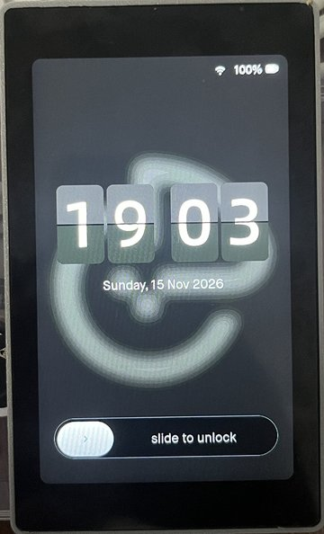
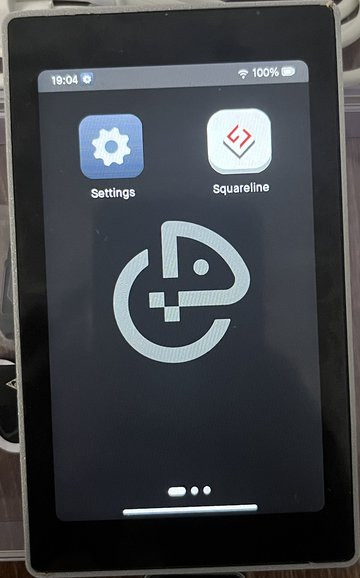
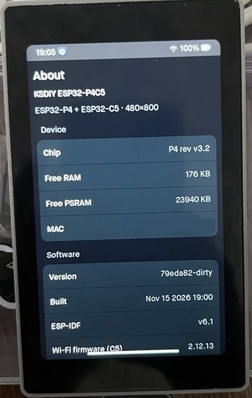

# BSP: ESP-Brookesia Phone example

## Overview

Runs the ESP-Brookesia Phone UI on the KSDIY ESP32-P4C5 4.3" board (480 x 800 panel, ST7102 over MIPI DSI, ST7123 touch), with a settings app and the system behavior of a small phone:

- **Launcher** with the Settings app and the Squareline demo app. The status bar shows the clock, Wi-Fi level and battery.
- **Settings app** (Vietnamese / English):
  - Wi-Fi: scan, connect, up to 5 saved networks with auto-reconnect, forget.
  - Display: brightness, screen timeout.
  - Sound: volume and mute.
  - Language, time zone (SNTP once Wi-Fi is up).
  - Power: power off and restart.
  - About: device, software versions (app, ESP-IDF, ESP32-C5 firmware, ESP-Hosted, LVGL, Brookesia), detected hardware, microSD size, battery and charger.
- **Lock screen**: flip clock, date, Wi-Fi and battery, slide to unlock, charging effect. The wallpaper is the launcher one, blurred at boot.
- **Screen power**: the screen dims after the timeout, then goes off with the lock screen up. While it is off, LVGL is paused and Wi-Fi uses modem sleep.
- **Keys**:
  - Power key, short press: lock screen, then screen off; wakes the screen when it is off.
  - Power key, long press: power menu (power off, restart).
  - IO0 / BOOT: volume up / down, with a volume panel under the status bar. They do nothing on the lock screen.
- **microSD**: mounted at `/sdcard` in the background at boot (never formatted).

Settings are stored in NVS (namespace `phone`).

| Lock screen | Launcher | Settings |
|---|---|---|
|  |  |  |

| About | Sound page with the volume panel |
|---|---|
|  |  |

## Hardware Requirements

* KSDIY ESP32-P4C5 4.3" board (ESP32-P4 rev v3.2, 16 MB flash, 32 MB PSRAM).
* On-board ESP32-C5 with the ESP-Hosted co-processor firmware 2.12.13 (as shipped) for Wi-Fi.
* Optional: battery on J2 (battery level, running without USB), microSD card, speaker.

## Software Requirements

* ESP-IDF v6.1.

## Layout

- `main/`: `main.cpp` starts the BSP display, the LVGL lock, the phone UI, the app registry and the services below.
- `components/phone_app_settings/`: the Settings app and the phone services:
  - `phone_app_settings.cpp`: Settings app pages.
  - `phone_net.cpp`: Wi-Fi service (saved networks, auto-reconnect, SNTP).
  - `phone_power.cpp`: battery polling, power key, power menu (AXP2101 through the BSP).
  - `phone_lock.cpp`: lock screen and screen power policy.
  - `phone_volume.cpp`: volume keys and volume panel.
  - `phone_audio.cpp`: speaker volume and the confirmation beep.
  - `phone_storage.cpp`: microSD mount.
  - `phone_locale.cpp`: language, time zone and small NVS preferences.
  - `fonts/`: UI fonts with Vietnamese glyphs (Be Vietnam Pro, 12 to 28 px, SIL Open Font License, see `fonts/OFL.txt`) and the 120 px clock digits.
  - `tools/gen_lv_font.py`: script that generated the UI fonts from the TTF (Python with Pillow).
- `components/brookesia_core/`: ESP-Brookesia core (phone system, GUI, stylesheets).
- `components/brookesia_app_squareline_demo/`: Squareline demo app.
- `components/phone_common_net/`: boot-time Wi-Fi for the RainMaker workflow; a no-op here (`CONFIG_RAINMAKER_APP_SUPPORT=n`).
- `../../bsp/esp32p4c5_bsp/`: board support package, pulled in through `main/idf_component.yml`.

## Configuration

- `Phone example → Mount the microSD card at boot` (`CONFIG_PHONE_SD_CARD_MOUNT`, default on).
- Wi-Fi goes through ESP-Hosted over SDIO; `sdkconfig.defaults` selects the ESP32-C5 as the co-processor.

## Build and Flash

Run the build from this directory:

```
idf.py set-target esp32p4
idf.py -p {port} flash monitor
```

To exit the serial monitor, type `Ctrl-]`.

## Notes

- LVGL is pinned to `^9` (9.5 in the current lock) by `brookesia_core`. A few `lv_part_t` conversions were changed to `LV_PART_MAIN` to build against it.
- The phone takes the default display and touch from LVGL (the BSP registers them), so no extra wiring is needed.
- The stock Brookesia fonts have no Vietnamese glyphs, so `main.cpp` replaces the 12 to 28 px system fonts in the stylesheet with the fonts of the Settings app (Be Vietnam Pro).
- The lock screen and the power menu are drawn on the LVGL system layer, above the Brookesia status and navigation bars.
- The slot has no card-detect pin: a card inserted after boot needs a restart.
- The AXP2101 has no battery current measurement, so the About page shows voltage and fuel gauge level only.
- BOOT (GPIO35) is also wired to the DTR line of the CH343P USB-UART bridge: a terminal on that port that asserts DTR reads as "volume down" held.
